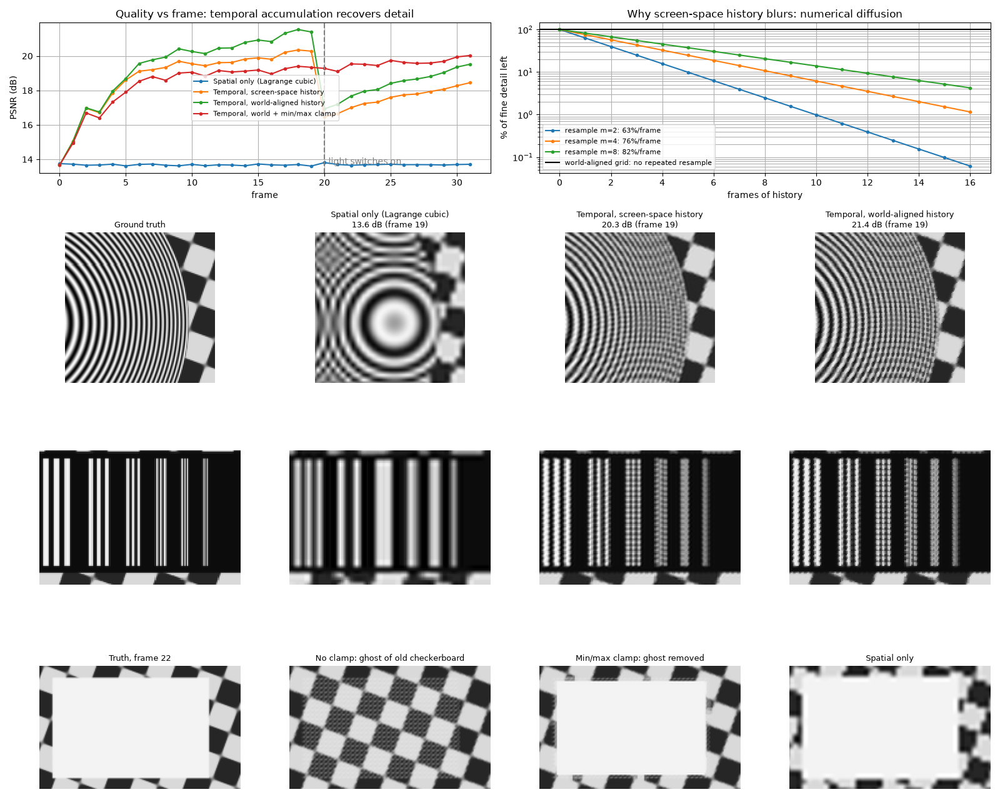

# Likes of DLSS: temporal super-resolution from numerical methods

A **4× temporal upscaler** in the style of NVIDIA DLSS and AMD FSR 2. It combines many jittered low-resolution frames into one sharp image, and it is built only from the numerical methods in our Numerical Methods lab syllabus: no neural network and no image-processing libraries. Every core method is written by hand in NumPy and checked against SciPy.

**Live demo: [likes-of-dlss.vercel.app](https://likes-of-dlss.vercel.app)**



## Headline results

PSNR on the last frame, against exact ground truth. Higher is better; +6 dB halves the RMS error.

| Scene | Resolution | Bilinear | Lagrange | Lanczos-3 | **Temporal (ours)** | Gain |
|---|---|---|---|---|---|---|
| Test scene | 128×128 → 512×512 | 14.04 | 13.71 | 13.25 | **23.66** | +9.62 dB |
| Test scene, held-out path | 128×128 → 512×512 | 13.98 | 13.66 | 13.20 | **22.31** | +8.33 dB |
| Cyberpunk 2077 | 320×180 → 1280×720 | 25.60 | 25.48 | 25.11 | **36.13** | +10.53 dB |
| Ghost of Tsushima | 320×180 → 1280×720 | 26.72 | 26.43 | 25.99 | **35.49** | +8.77 dB |
| Phantom Blade Zero | 320×180 → 1280×720 | 27.64 | 27.46 | 27.05 | **37.22** | +9.58 dB |
| Sifu | 320×180 → 1280×720 | 29.11 | 29.04 | 28.69 | **39.74** | +10.63 dB |

That is roughly **3× lower RMS error** than the best single-frame method on every scene. The temporal method recovers detail no single frame contains: the real rings of the zone plate, bars thinner than one low-res pixel, and readable signs in the game scenes.

Two findings stand out:
- **Sharper filters do worse.** Lanczos-3, the standard high-quality resize, scores *lowest* of the single-frame filters, because sharper reconstruction amplifies the aliasing in one frame's samples.
- **The parameters transfer.** They were tuned on the test scene only, then held up on a held-out camera path and on four games they never saw.

## How it works

DLSS gets jittered low-res frames and motion vectors from the game, and combines many frames into one sharp image. We do the same thing classically:

1. **Render.** An analytic test scene gives exact ground truth. Each pixel is an area integral, computed with **Simpson's 1/3 rule**. The camera jitters by a sub-pixel **Halton (2, 3)** offset every frame.
2. **Gather and accumulate.** Each new sample adds to nearby high-res pixels with Gaussian weights, forming a confidence-weighted least-squares estimate. History lives on a world-aligned grid, so it is never re-interpolated and doesn't suffer numerical diffusion.
3. **Anti-ghosting.** History is clamped to what the current frame sees nearby. The clamp is widened where the **power method** (structure-tensor eigenvalues) finds edges, so it removes ghosts without cutting detail.
4. **Display.** One **Lagrange** resample, then edge-preserving anisotropic diffusion stepped with **RK4**, only where evidence is thin.
5. **Tuning.** Two parameters are fitted to ground truth by **bisection, regula falsi, secant and Newton-Raphson**. This is our counterpart to DLSS training.
6. **Motion estimation** (optional). Registration is solved as a nonlinear 2×2 system by **Gauss-Newton**, cross-checked against `fsolve`.

**Game scenes** use a screenshot as the ground-truth world: a simulated renderer pans across it and takes 320×180 Halton-jittered samples, and the unchanged upscaler rebuilds 1280×720, one colour channel at a time. The jitter is simulated, not the game engine's own (`decisions.md` §22).

## Syllabus coverage

| Exp | Topic | Where it's used | Evidence |
|---|---|---|---|
| 2(a–d) | Bisection, Newton-Raphson, Secant, Regula Falsi | Parameter tuning (`tsr/rootfind.py`) | `out/05_tuning.png`: convergence and cost in pipeline runs |
| 2(e) | Nonlinear systems, `linalg.solve`, `fsolve` | Motion estimation (`tsr/motion.py`) | `out/06_motion.png` |
| 3 | Lagrange interpolation | Upscaling and resampling (`tsr/interp.py`) | `out/02_spatial.png`, Lebesgue constants |
| 4 | Newton forward/backward differences | Equivalent interpolation forms; finite-difference gradients and derivatives | Verified equal to Lagrange to 7×10⁻¹⁶ |
| 5, 6 | Trapezoidal, Simpson's 1/3 | Pixel integration (`tsr/quadrature.py`) | `out/01_frames.png`: O(h²) vs O(h⁴) |
| 7 | RK4 | Anisotropic diffusion (`tsr/diffusion.py`) | `out/04_edges.png`: stability limits, order 1 vs order 4 |
| 8 | Power method | Edge detection, and the spectral radius for a stable time step (`tsr/edges.py`) | Convergence rate (λ₂/λ₁)² |
| 1 | Harmonic series | Not used; no natural fit | — |

## Run it

```bash
python -m venv .venv && .venv/bin/pip install -r requirements.txt
.venv/bin/python -m pytest -q tests     # 17 tests
.venv/bin/python scripts/03_temporal.py # any module's figure → out/
```

The first run renders the scene, which takes about 40 s; after that it's cached in `out/cache/`.

### The demo (React)

```bash
.venv/bin/python scripts/export_web.py  # test scene: every method × frame, about 3 min
cd web && npm install && npm run dev    # open the printed localhost URL
```

`web/` is a static React + Vite app, so no Python runs at demo time and it works offline (fonts are self-hosted). It has:
- **a draggable wipe** between any two methods (arrow keys move it too)
- **frame scrubbing and playback**
- **regions to zoom into**: stress-test presets, auto-picked "biggest gain" tiles, or click anywhere on the thumbnail
- **an error heatmap**, |output − truth| for both sides of the wipe
- **a PSNR table and one large PSNR chart** you can click to seek
- **a benchmarks page** ("Read the benchmarks") with every measured result, its figure and its decision
- **the view kept in the URL**, so a link reopens the exact comparison

### Game scenes and your own frames

```bash
.venv/bin/python scripts/import_scene.py image uploads/shot.jpg --name "Cyberpunk 2077"   # about 3.5 min
.venv/bin/python scripts/import_scene.py raw my_frames/ --name "My renders"              # your jittered frames + frames.json
```

Or use **Add a scene** in the page, which uploads a screenshot, or your jittered frames plus their `frames.json`, and shows the import's progress. That needs `npm run dev`, because the dev server runs the Python importer; the hosted site shows how to import from a terminal instead. Raw mode has no ground truth, so it shows no scores. Its `frames.json` must give each frame's jitter and camera motion (estimating motion is available behind `--estimate-motion`, but is unreliable; see `decisions.md` §21).

### Deploying

The full demo data is about 200 MB, over the 100 MB that Vercel's Hobby plan accepts from the CLI. `scripts/prepare_deploy.py` makes a slimmed copy in `web/deploy/`:
- test-scene frames become WebP at quality 95, and game scenes WebP at quality 85;
- the held-out path's frames and the raw scenes are dropped.

That comes to about 81 MB. The scores are computed before compression, so they stay exact.

```bash
cd web && npm run build && cd ..
.venv/bin/python scripts/prepare_deploy.py
cd web/deploy && vercel deploy --prod
```

## Tech stack

| Layer | Tools |
|---|---|
| Numerics | Python 3.12, NumPy (every method hand-written) |
| Verification | SciPy (`integrate`, `interpolate`, `optimize`), `numpy.linalg`, pytest |
| Images and figures | Pillow, Matplotlib |
| Demo | React 18, Vite 5, HTML canvas (wipe and heatmap), inline SVG (chart), self-hosted fonts |
| Design | [Hallmark](https://github.com/Nutlope/hallmark) design skill, Almanac theme |
| Hosting | Vercel (static) |

## Project layout

```
tsr/              the upscaler: quadrature, scene, frames, interp, temporal, edges,
                  diffusion, rootfind, motion, photo, metrics
scripts/          01–06: one demo and figure per module
                  export_web.py, import_scene.py: data for the demo
                  prepare_deploy.py: the slimmed hosting copy
tests/            hand-written methods checked against SciPy / numpy.linalg
web/              React demo
decisions.md      every core design decision, with the measurement behind it
understanding.md  plain-language guide: pipeline, methods, glossary, 50-question quiz
app.py            older Streamlit version of the demo
```

## Limitations

- **The motion is a global camera pan.** The world-aligned history depends on that. Real per-object motion would need per-pixel screen-space reprojection, which reintroduces blur (measured in `decisions.md` §12).
- **Game scenes use simulated jitter** from a screenshot, not frames from the game engine itself.
- **Estimated motion is biased** without engine motion vectors, by 0.2–0.9 px from aliasing, which costs about 2.7 dB. That is the reason DLSS requires motion vectors (§21).
- **Parameters were tuned on the test scene.** The held-out path and the four games confirm the gain, but a wider study would be stronger.
- **The game screenshots belong to their publishers.** They stay out of this repository; only the derived, compressed frames are hosted, for the demo.
